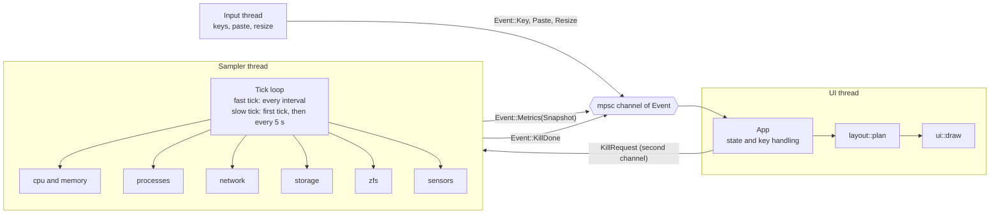
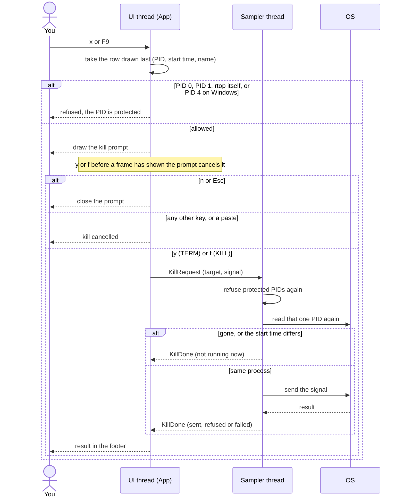
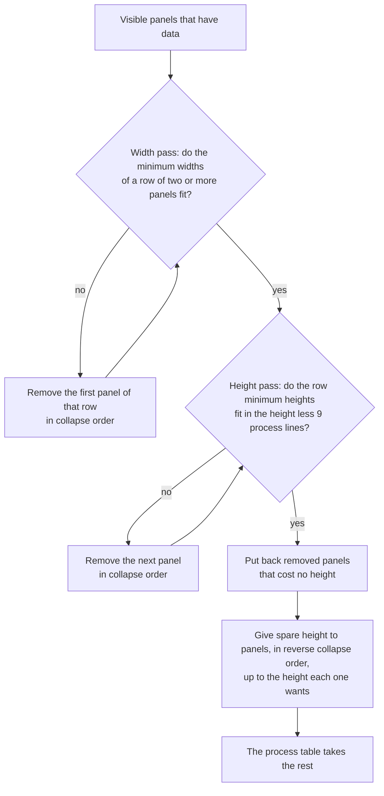
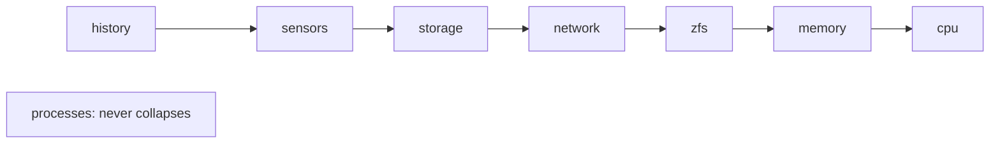
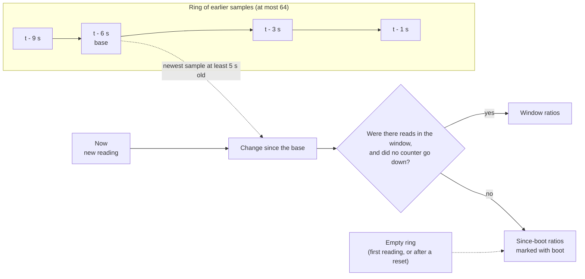

<h1 align="center">rtop</h1>

<p align="center">
  <strong>A small terminal system monitor with a ZFS ARC panel, storage, sensors and a process tree.</strong>
</p>

<p align="center">
  <a href="https://github.com/DarkWaveLabs/rtop/actions/workflows/ci.yml"></a>
  <a href="LICENSE"></a>
  
  
  
  
</p>

<p align="center">
  <a href="#features">Features</a> ·
  <a href="#install">Install</a> ·
  <a href="#usage">Usage</a> ·
  <a href="#keys">Keys</a> ·
  <a href="#config">Config</a> ·
  <a href="#platforms">Platforms</a> ·
  <a href="#design">Design</a> ·
  <a href="#contributing">Contributing</a>
</p>

<p align="center">
  
  <br>
  <sub>The default layout on Linux. The demo host has no ZFS pool, so the ZFS ARC panel shows a synthetic ARC that rtop reads from a fixture file.</sub>
</p>

**Quick start:** install with `cargo install --git https://github.com/DarkWaveLabs/rtop --locked` (Rust 1.95 or later, or see [Install](#install) for binaries), run `rtop`, and press `?` for the keys.

## Why rtop

> "none of them report ZFS ARC stats, so I gave up and went back to top"
>
> — a user

Many terminal monitors leave out the ZFS ARC. On a ZFS host, the ARC can hold a large share of RAM. On Linux, the kernel's `MemAvailable` figure leaves the ARC out, so a tool that trusts it shows the ARC as used memory.

rtop has a ZFS ARC panel. It shows the ARC size against its target, the hit ratio, the MFU and MRU split, and the L2ARC. On Linux, it also counts the part of the ARC that can shrink as free memory, so the memory gauge shows what applications use.

The rest of rtop is as useful as `top` is, and more: a process tree, per-process disk I/O, filesystems, disk rates, temperatures and the battery. It is one self-contained binary of about 0.9 to 1.1 MiB for each architecture. It has no runtime dependencies.

## Features

**CPU and memory**

- A bar for each CPU core. When the panel is short, it adds columns.
- A history graph of CPU and memory use for the last 120 samples, drawn with Braille glyphs.
- RAM and swap gauges, the process count and the core count.
- A header line with the host name, OS, CPU, uptime and load average.

**ZFS ARC**

- The ARC size, the target, and the minimum and maximum sizes, with a gauge.
- Hit ratio, I/O-hit ratio and miss ratio, and the demand data (`dd`) and demand metadata (`dm`) hit ratios.
- Hit ratios are for a 5 second window. The panel marks a value as `boot` when it is a since-boot ratio. See [How the hit ratio works](#how-the-hit-ratio-works).
- The MFU and MRU sizes with a split bar. The data and metadata sizes. The compression ratio.
- The L2ARC size, allocated size and hit ratio, when an L2ARC exists.
- On Linux, the memory gauge counts the shrinkable ARC (size minus `c_min`) as free memory. htop does the same. The memory panel also shows the ARC size on every OS that has ZFS.
- The panel appears only when ZFS is loaded. It reads the ARC counters on Linux, FreeBSD and macOS (OpenZFS on OS X). Windows has no ARC reader.

**Storage**

- Used and total space for each filesystem, with a meter. Pseudo filesystems and snap mounts are hidden.
- A ZFS child dataset folds into its pool when the pool root is also listed. The `/` mount is always kept.
- Read and write rates for each disk. Volumes on one disk count once, for example the APFS volumes of one container on macOS.
- Volumes with no disk counter, such as ZFS datasets, `tmpfs` and network filesystems, show `n/a`. Mount points that are files, such as the `/etc/hosts` that Docker bind-mounts, are hidden.

**Sensors**

- Temperatures from the hardware sensors, hottest first, in °C or °F. The unit is set with `temp_unit` in the [config file](#config); no key changes it. The colour shows how close each reading is to its critical value.
- The battery level and state: charging, discharging, full, not charging or unknown.
- The panel appears only when the host reports a sensor.

**Network**

- Total receive and transmit rates, with sparklines.
- A view for each interface (`n`): receive and transmit rates and the totals since boot. Loopback interfaces and interfaces with no traffic since boot are hidden.

**Processes**

- Columns for PID, user, state, threads, CPU, memory, disk read and disk write rates, and name.
- Sort by CPU, memory, I/O, PID or name. Reverse the sort with `r`.
- A filter by name or exact PID.
- A tree view with branch lines. Siblings follow the sort order.
- The full command line, in place of the name (`c`).
- Kill a process with a confirm prompt. See [Kill safety](#kill-safety).

**Layout and config**

- An adaptive layout. Panels collapse in a fixed order when the terminal is small, and the footer shows how many are hidden. It works at 80×24.
- Keys `1` to `8` show or hide each panel. `0` shows them all.
- A help overlay (`?`) that reads the same key table as `--help`.
- An optional [config file](#config) and a few command-line flags.
- No telemetry. rtop opens no network ports and sends no data off the machine.

### More screenshots

<details>
<summary>Tree view, help overlay and the 80×24 layout</summary>

<br>

<table>
  <tr>
    <td width="50%" valign="top">
      
      <br><sub>Tree view (<code>t</code>) with command lines (<code>c</code>). Panels 2 to 6 are hidden with their toggle keys.</sub>
    </td>
    <td width="50%" valign="top">
      
      <br><sub>The help overlay (<code>?</code>).</sub>
    </td>
  </tr>
  <tr>
    <td width="50%" valign="top">
      
      <br><sub>The adaptive layout at 80×24. The history panel collapsed, and the footer says <code>· 1 hidden</code>.</sub>
    </td>
    <td width="50%" valign="top">
      The screenshots come from a Linux container. The storage panel shows a Docker volume mounted at <code>/data</code>. The ZFS ARC panel reads a synthetic fixture, not a real pool.
    </td>
  </tr>
</table>

</details>

## Install

No release is published yet. Install from source with Rust 1.95 or later ([rustup](https://rustup.rs)). When a release is tagged, static binaries appear on the [releases page](https://github.com/DarkWaveLabs/rtop/releases).

```sh
cargo install --git https://github.com/DarkWaveLabs/rtop --locked
```

Or build it from a clone:

```sh
git clone https://github.com/DarkWaveLabs/rtop.git
cd rtop
cargo build --release --locked
./target/release/rtop
```

The release profile builds for size (`opt-level = "s"`, LTO, stripped). The result for version 0.2.0 is 904 KiB on macOS arm64 and 1.07 MiB for the Docker build below (Linux arm64, musl).

To build a static Linux binary with Docker, so you need no Rust toolchain on the host:

```sh
mkdir -p dist
docker run --rm -v "$PWD":/src:ro -v "$PWD/dist":/out -w /src \
  -e CARGO_TARGET_DIR=/tmp/target rust:1.99-alpine \
  sh -c 'cargo build --release --locked && cp /tmp/target/release/rtop /out/rtop-linux-musl'
```

### Release binaries

When a release is tagged (`v*`), the [release workflow](.github/workflows/release.yml) builds one binary for each platform and publishes them on the GitHub releases page with a `SHA256SUMS` file:

| File | Platform |
|---|---|
| `rtop-macos-universal` | macOS, Apple Silicon and Intel (two builds joined with `lipo`) |
| `rtop-linux-x86_64-musl` | Linux x86_64, statically linked |
| `rtop-linux-aarch64-musl` | Linux arm64, statically linked |
| `rtop-windows-x86_64.exe` | Windows x86_64. The C runtime is linked statically, so the Visual C++ Redistributable is not necessary. |

To check a download, run the check on the one line for your file. On Linux, use `sha256sum -c`. On macOS, use `shasum -a 256 -c`.

```sh
grep rtop-linux-x86_64-musl SHA256SUMS | sha256sum -c
```

Then make the file executable and move it to a directory on your `PATH`, for example:

```sh
chmod +x rtop-linux-x86_64-musl
mv rtop-linux-x86_64-musl ~/.local/bin/rtop
```

- **macOS.** The binary is not signed. If you downloaded it with a browser, Gatekeeper blocks the first run. Remove the quarantine flag first: `xattr -d com.apple.quarantine rtop-macos-universal`.
- **Windows.** SmartScreen may warn about an unknown publisher. Choose **More info**, then **Run anyway**.

## Usage

```sh
rtop                      # start with the defaults
rtop -i 500               # refresh every 500 ms
rtop --tree               # start in the tree view
rtop --config ./my.toml   # read this config file
rtop --no-config          # ignore the config file
```

rtop uses 24-bit colour, rounded box characters and Braille glyphs. Use a terminal that supports them.

| Option | Meaning |
|---|---|
| `-i`, `--interval <ms>` | Refresh interval, 250 to 8000 ms. Default 1000. A value outside the range is moved to the nearest limit. |
| `-c`, `--config <path>` | Read this config file, not the default one. A missing file is an error. |
| `--no-config` | Read no config file. You cannot use it with `--config`. |
| `-t`, `--tree` | Start in the tree view. |
| `-h`, `--help` | Show the help text, with the key list. |
| `-V`, `--version` | Show the version. |

The refresh interval sets how often rtop samples. Slow data refreshes less often: the disk list and space, sensors, the battery, the user list and command lines refresh every 5 seconds, and so do macOS thread counts.

### The process table

The table adds columns as the terminal gets wider.

| Terminal width | Columns |
|---|---|
| 99 or more | PID, USER, S (state), THR (threads), CPU%, MEM, READ/s, WRITE/s, NAME |
| 63 to 98 | The same, without READ/s and WRITE/s |
| Under 63 | PID, CPU%, MEM, NAME |

On Windows, the S and THR columns are hidden. On FreeBSD, THR shows `-`.

Without root, the OS hides some data about other users' processes. Their READ/s and WRITE/s show `0`, not `-`, because rtop cannot tell a hidden counter from an idle one. On macOS, their command lines stay `[name]`.

The `s` key goes to the next sort column in this order: CPU, memory, I/O, PID, name. CPU, memory and I/O sort from high to low. PID and name sort from low to high. The `r` key reverses the direction. A command line is read on a slow tick, so a new process shows as `[name]` for up to 5 seconds when you show command lines.

The filter (`/`) matches part of a process name, ignoring case, or an exact PID. When you show command lines (`c`), it also matches the command line.

### Kill safety

Select a process and press `x` or `F9`. rtop then asks before it sends a signal.

- **Confirm prompt.** The prompt names the PID and the process. `y` sends `TERM`. `f` sends `KILL`. `n` or `Esc` cancels.
- **The target is fixed.** rtop takes the target from the row that the last frame highlighted, and the prompt keeps it. A re-sort cannot change which process gets the signal.
- **Protected PIDs.** rtop refuses PID 0, PID 1, its own PID and (on Windows) the System process, PID 4. It refuses before it opens the prompt, and again when it sends the signal.
- **PID reuse.** Before it signals, the sampler reads the process again and compares the start time. If the PID now belongs to a new process, rtop does not send the signal and says so.
- **Paste cannot trigger it.** rtop turns on bracketed paste, so pasted text arrives as one event, not as key presses. A paste cancels the prompt. Any key other than `y`, `f`, `n` and `Esc` also cancels it, and `y` or `f` pressed before a frame has shown the prompt cancels it.
- **Windows.** `f` opens the process, checks its creation time and calls `TerminateProcess` on that same handle. `y` (`TERM`) is not supported on Windows, and rtop tells you so.
- **Permissions.** If the OS refuses the signal, the footer says `permission denied or process gone`. rtop does not escalate.

The result of every kill shows in the footer.

## Keys

This table follows the help overlay and `--help`. Both read one key table in the code (`KEYMAP` in `src/help.rs`).

**General**

| Key | Action |
|---|---|
| `q`, `Ctrl-C` | Quit |
| `?`, `F1` | Show the help |
| `space` | Pause or resume |
| `+` `=` / `-` | Interval ×2 / ×0.5 (250 to 8000 ms) |
| `Esc` | Clear the filter or the footer message |

**Processes**

| Key | Action |
|---|---|
| `↑` `↓` `j` `k` | Move the selection |
| `PgUp` `PgDn` | Move by 10 rows |
| `Home` `g` / `End` `G` | First / last row |
| `s` | Next sort column |
| `r` | Reverse the sort |
| `t` | Tree view on or off |
| `c` | Show the name or the command line |
| `x`, `F9` | Kill the selected process |

**Panels**

| Key | Action |
|---|---|
| `1` | Show or hide cpu |
| `2` | Show or hide history |
| `3` | Show or hide memory |
| `4` | Show or hide network |
| `5` | Show or hide storage |
| `6` | Show or hide zfs |
| `7` | Show or hide sensors |
| `8` | Show or hide processes |
| `0` | Show all panels |
| `n` | Network: total or per interface |

A panel that has no data on your host takes no space. Pressing its key shows `<panel>: not available here`.

**Filter, help and kill prompt**

| Key | Action |
|---|---|
| `/` | Start the filter |
| `Backspace` | Filter: edit |
| `Enter` / `Esc` | Filter: keep / clear |
| `Esc` `?` `q` `F1` | Close the help |
| `y` | Kill: send `TERM` |
| `f` | Kill: send `KILL` |
| `n`, `Esc` | Kill: cancel |

## Config

A config file is optional. rtop reads it once, before it starts the display.

**Path**

| OS | Default path |
|---|---|
| Linux, macOS, FreeBSD | `$XDG_CONFIG_HOME/rtop/config.toml` when that variable is set to an absolute path. Otherwise `~/.config/rtop/config.toml`. |
| Windows | `%APPDATA%\rtop\config.toml` |

A missing file at the default path is fine. Use `--config <path>` to read another file (a missing file is then an error), or `--no-config` to read none.

**Precedence:** command line, then config file, then built-in default. The flags that overlap are `-i` and `-t`. The `--tree` flag can only turn the tree on.

**Keys**

| Key | Type | Default | Values | Example |
|---|---|---|---|---|
| `interval_ms` | integer | `1000` | 250 to 8000. A value outside the range is moved to the nearest limit. | `interval_ms = 500` |
| `sort` | string | `"cpu"` | `"cpu"`, `"mem"`, `"io"`, `"pid"`, `"name"` | `sort = "mem"` |
| `reverse` | boolean | `false` | `true`, `false` | `reverse = true` |
| `tree` | boolean | `false` | `true`, `false` | `tree = true` |
| `command` | boolean | `false` | Show the command line, as the `c` key does. | `command = true` |
| `panels` | array of strings | all panels | `"cpu"`, `"history"`, `"memory"`, `"network"`, `"storage"`, `"zfs"`, `"sensors"`, `"processes"` | `panels = ["cpu", "memory", "processes"]` |
| `temp_unit` | string | `"c"` | `"c"`, `"f"` | `temp_unit = "f"` |
| `network` | string | `"total"` | `"total"`, `"interfaces"` | `network = "interfaces"` |

**Example `config.toml`** (every key, with its default value, except where the comment says otherwise):

```toml
# ~/.config/rtop/config.toml

interval_ms = 1000          # 250 to 8000
sort        = "cpu"         # "cpu", "mem", "io", "pid" or "name"
reverse     = false
tree        = false
command     = false         # show command lines, not names

# Panels to show at start. Leave this key out to show all of them.
panels = ["cpu", "history", "memory", "network", "storage", "zfs", "sensors", "processes"]

temp_unit = "c"             # "c" or "f"
network   = "total"         # "total" or "interfaces"
```

**Format.** The parser reads a flat subset of TOML: `key = value` lines and `#` comments.

- Values are integers, `true` or `false`, quoted strings, and one-line arrays of quoted strings.
- A string supports two escapes only: `\"` and `\\`.
- Tables (`[section]`) are not supported.
- The file must be UTF-8 and at most 64 KiB.

**Errors**

- A syntax error, a duplicate key, a wrong type or an unknown value stops rtop before the display starts. rtop prints the path and the line to stderr and exits with code 1. For example: ``rtop: config <path>: line 1: unknown value `x` for `sort`; expected one of: cpu, mem, io, pid, name``.
- An unknown key is not an error. rtop ignores it and shows a warning in the footer (``line 3: unknown key `colour`, ignored``) until you press a key.
- A panel name that is not valid in `panels` is an error. A valid panel that your host cannot show, such as `zfs` without ZFS, takes no space.

## Platforms

rtop is one code base. Each OS has its own readers behind `cfg` attributes, so a build for one OS does not contain the code for the others.

| Feature | Linux | macOS | Windows | FreeBSD |
|---|:-:|:-:|:-:|:-:|
| CPU, memory, swap, history, processes | ✅ | ✅ | ✅ | ✅ |
| Load average | ✅ | ✅ | ➖ ¹ | ✅ |
| Network rates, total and per interface | ✅ | ✅ | ✅ | ✅ |
| Storage: filesystems and space | ✅ | ✅ | ✅ | ✅ |
| Storage: disk I/O rates | ✅ | ✅ | ✅ | ✅ |
| **ZFS ARC panel** | ✅ | ✅ | ❌ | ✅ |
| ARC counted as free memory | ✅ | ❌ | ❌ | ✅ ² |
| Process tree, sort, filter, command line | ✅ | ✅ | ✅ | ✅ |
| Process state column (S) | ✅ | ✅ | ❌ ³ | ✅ |
| Process threads column (THR) | ✅ | ✅ | ❌ ³ | ➖ ⁴ |
| Process disk I/O (READ/s, WRITE/s) | ✅ | ✅ | ✅ | ➖ ⁵ |
| Kill with `TERM` | ✅ | ✅ | ❌ | ✅ |
| Kill with `KILL` | ✅ | ✅ | ✅ | ✅ |
| Temperatures | ✅ | ✅ | ➖ ⁶ | ➖ ⁶ |
| Battery | ✅ | ✅ | ✅ | ❌ |
| Config file | ✅ | ✅ | ✅ | ✅ |
| Release binary | ✅ | ✅ | ✅ | ❌ build from source |

✅ implemented · ➖ partial or limited · ❌ not available. See [What is tested](#what-is-tested).

1. `sysinfo` documents the load average as not working on Windows.
2. On FreeBSD, `sysinfo` subtracts the ARC from used memory. On Linux, rtop does it. On macOS, rtop does not adjust the memory gauge.
3. Windows reports every process as running and gives no thread counts, so rtop hides both columns.
4. FreeBSD shows `-`. `sysinfo` gives no thread count there.
5. On FreeBSD, `sysinfo` fills these values from the kernel's block counters, not byte counts. Treat them as a rough guide.
6. rtop shows what the `sysinfo` crate finds. On Windows it reads one thermal-zone value. On FreeBSD it reads `dev.cpu.<n>.temperature`, which needs a CPU temperature driver. The panel is hidden when the host reports nothing.

### What is tested

| Platform | Status |
|---|---|
| Linux | Unit tests, `clippy` and `rustfmt` run in CI on every pull request. The screenshots come from a Linux container (Alpine, arm64). |
| macOS | Developed on macOS. The release workflow builds the universal binary. CI does not run macOS tests. |
| Windows | The release workflow builds the binary and runs `--help`. `clippy` passes for `x86_64-pc-windows-msvc`. **Not yet run-tested** on a live system. |
| FreeBSD | `clippy` passes for `x86_64-unknown-freebsd`. It **builds, but it is not yet run-tested**. No release binary. |

The ZFS ARC reader has only been tested with synthetic fixtures (`testdata/`), not on a real ZFS pool. If you run ZFS and the numbers look wrong, please open an issue and include the output of `cat /proc/spl/kstat/zfs/arcstats` (Linux) or `sysctl kstat.zfs.misc.arcstats` (FreeBSD and macOS).

## Design

### How it fits together

Three threads talk through channels. The sampler thread owns all the `sysinfo` handles and all the collectors. The UI thread owns the application state and draws.



Fast ticks read the CPU, memory, processes, network, disk I/O counters and ZFS counters. Slow ticks add the work that costs more: the disk list and space, sensors and the battery, the user list, command lines and macOS thread counts. A host without ZFS is checked again only on a slow tick.

### The kill flow



On Windows, the sampler opens the process, compares its creation time and terminates through that same handle. The sampler checks the kill channel every 50 ms while it waits for the next tick, so a kill starts within about 50 ms, or once the current sample finishes.

### Layout collapse

`layout::plan` is a pure function. It takes the body area and the panels that the user shows and that have data. It returns the area for each panel and the list of panels it removed.



The collapse order, from the first panel to go to the last:



The panels sit in three rows above the process table: cpu and history, then memory and network, then storage, zfs and sensors. A row is as tall as its tallest panel's minimum, so removing a tall panel from a row can free space. At 80×24 with every panel shown, the three rows need 15 lines but only 13 are free, so history goes first. The footer then shows `· 1 hidden`. On a host that also has sensors, row three needs 88 columns (30 + 36 + 22), so sensors drops too and the footer shows `· 2 hidden`. The screenshot host has no sensors. The process table always keeps at least 9 lines (6 process rows).

### How the hit ratio works

The ZFS counters only go up, so a ratio since boot hides what the cache is doing now. rtop keeps a ring of earlier readings (at most 64) and compares the new reading with a base reading.



- The base is the newest sample that is at least 5 seconds old. Until one is that old, it is the oldest sample, so the window is shorter than 5 seconds at start-up.
- If the pool did no reads in the window, or a counter went down (for example after a module reload), the panel shows since-boot ratios with a `boot` label, so you know they are not live.
- `hit` is hits divided by all reads (hits, I/O hits and misses). `io` is the I/O-hit share, and `miss` is what is left. `dd` and `dm` are the hit ratios for demand data and demand metadata reads.
- On a narrow panel, the hit line drops `dm`, `dd`, `miss` and `io`, in that order.

### Principles

- **No locks.** The sampler moves each `Snapshot` into the channel. The two threads cannot touch the same data, and the compiler checks this. The refresh interval is the only shared value, and it is an atomic.
- **No busy loop.** The UI thread blocks on `recv()`. It then reads all waiting events, so a burst of keys costs one redraw.
- **The terminal resets after a panic.** `ratatui::run` restores raw mode and the alternate screen on every exit path, and a guard turns bracketed paste off again.
- **Logic without I/O.** Decisions live in pure functions: `app.rs` has no terminal code, `layout::plan` is pure, and `config::parse` and `zfs::parse_kstat` take text, not files. Plain unit tests cover them. The UI tests render into ratatui's `TestBackend`.
- **Cheap sampling.** Slow work runs on a slow tick every 5 seconds, so a 250 ms interval stays light.
- **Few dependencies.** rtop has three direct crates on every OS: `anyhow`, `ratatui` and `sysinfo`. The config parser and the command-line parser are hand-written. `unsafe` code is for OS calls only (`sysctlbyname`, `statfs`, `proc_pidinfo`, IOKit power sources, and the Windows process and power APIs), and each block has a `SAFETY` comment.

### File map

| File | Contents |
|---|---|
| `src/main.rs` | CLI parsing, the `--help` text, config loading, thread setup and the event loop |
| `src/metrics.rs` | The sampler thread, which owns the `sysinfo` handles and the collectors and sends one `Snapshot` for each tick |
| `src/app.rs` | Application state, the history ring buffer, sort, filter and key handling |
| `src/ui.rs` | The frame, the header and footer, and the CPU, history, memory and network panels |
| `src/ui/` | One drawing file for each feature panel (`zfs.rs`, `storage.rs`, `sensors.rs`, `process.rs`, `net.rs`) and the help overlay (`help.rs`) |
| `src/layout.rs` | The pure layout planner: which panels fit, where they go and which collapse |
| `src/panel.rs` | Panel identities and the set of visible panels |
| `src/help.rs` | The key table (`KEYMAP`) that the help overlay and `--help` read |
| `src/config.rs` | The config parser and the default path rules |
| `src/process.rs` | Process data, sort, filter, the tree and kill |
| `src/storage.rs` | Filesystem usage and disk I/O rates |
| `src/zfs.rs` | The ARC kstat parser, the hit-ratio window and a reader for each OS |
| `src/sensors.rs` | Temperatures and the battery reader for each OS |
| `src/net.rs` | Per-interface network rates and totals |
| `src/format.rs` | Formatters for bytes, rates and durations, and the bar meter |
| `src/order.rs` | One shared stable sort, which keeps the binary small |

The full design for the feature round that added the ZFS, storage, sensors and process features is in [`docs/designs/features/2026-10-16-rtop-feature-round-1.md`](docs/designs/features/2026-10-16-rtop-feature-round-1.md). Where it differs from the code, the code is correct.

## Develop

Run the checks that CI runs:

```sh
cargo fmt --check
cargo clippy --all-targets --locked -- -D warnings
cargo test --locked
```

The code for each OS sits behind `cfg` attributes, so a Linux build does not compile the macOS, Windows or FreeBSD code. Run clippy for the other targets too. These checks need no linker, only the targets:

```sh
rustup target add x86_64-unknown-linux-musl x86_64-pc-windows-msvc x86_64-unknown-freebsd aarch64-apple-darwin
for t in x86_64-unknown-linux-musl x86_64-pc-windows-msvc x86_64-unknown-freebsd aarch64-apple-darwin; do
  cargo clippy --all-targets --locked --target "$t" -- -D warnings || break
done
```

To run the tests on Linux from another OS, use Docker:

```sh
docker run --rm -v "$PWD":/src:ro -w /src -e CARGO_TARGET_DIR=/tmp/target \
  rust:1.99-alpine cargo test --locked
```

### Try the ZFS panel without ZFS

A debug build (`cargo run`, not `--release`) reads the ARC counters from a file when `RTOP_ZFS_ARCSTATS` is set. A release build ignores the variable.

```sh
RTOP_ZFS_ARCSTATS=testdata/arcstats-2.2.txt cargo run
```

The file does not change, so there are no reads in the window. The hit values then show the since-boot ratios with the `boot` label. The fixtures in `testdata/` are synthetic.

## Contributing

Bug reports, ideas and pull requests are welcome. Read [CONTRIBUTING.md](CONTRIBUTING.md) first. It lists the checks, the code rules and the commit style. For a new feature, open an issue before you write the code, because rtop stays small on purpose. The changes for each version are in [CHANGELOG.md](CHANGELOG.md).

## Security

To report a vulnerability, do not open a public issue. Follow [SECURITY.md](SECURITY.md).

## Licence

rtop is released under the MIT licence. See [LICENSE](LICENSE). Copyright (c) 2026 DarkWaveLabs.

## Acknowledgements

- [ratatui](https://ratatui.rs) draws the terminal interface.
- [sysinfo](https://crates.io/crates/sysinfo) reads the system data on every OS.
- [OpenZFS `arcstat`](https://github.com/openzfs/zfs) gave the idea of a hit ratio over a time window.
- [htop](https://htop.dev) counts the shrinkable ARC as free memory, as rtop does on Linux.
