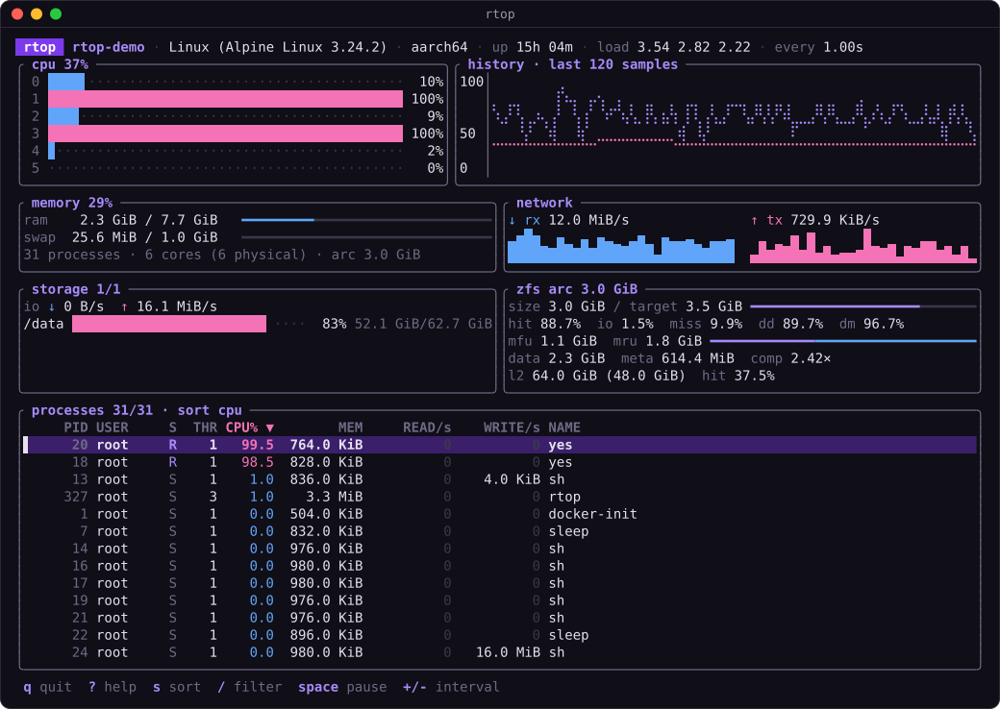
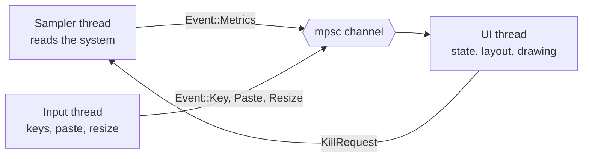
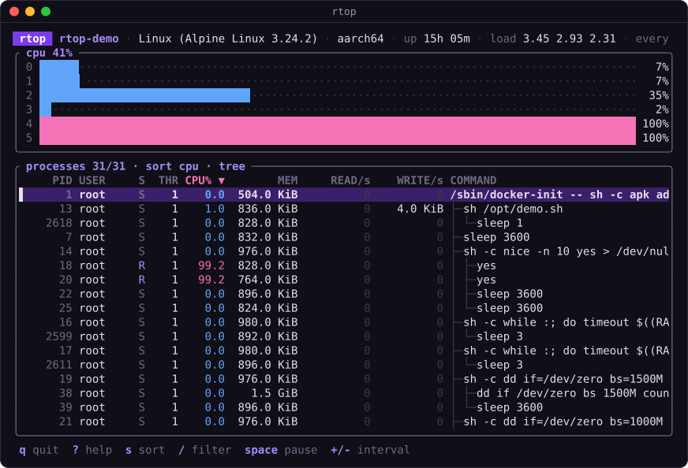
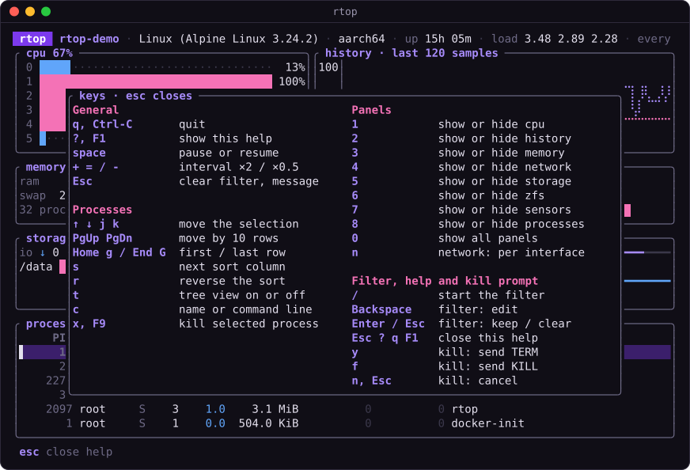
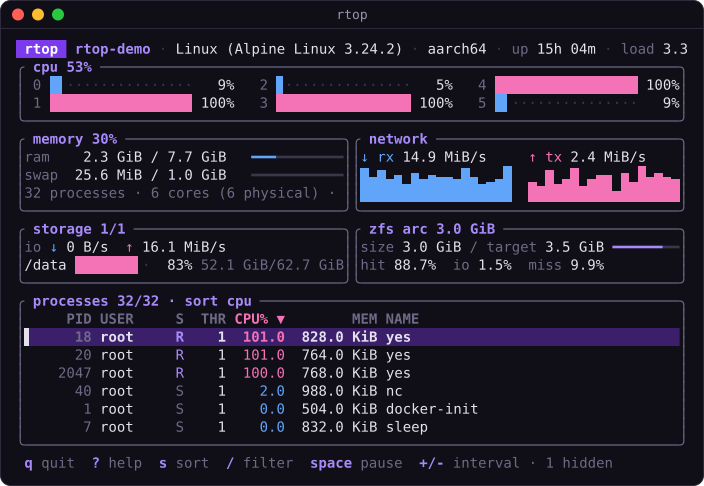

<h1 align="center">rtop</h1>

<p align="center">
  <strong>A small terminal system monitor with a ZFS ARC panel, storage, sensors and a process tree.</strong>
</p>

<p align="center">
  <a href="https://github.com/DarkWaveLabs/rtop/actions/workflows/ci.yml"></a>
  <a href="LICENSE"></a>
  
  
  
  
</p>

<p align="center">
  <a href="#install">Install</a> ·
  <a href="#quick-start">Quick start</a> ·
  <a href="#documentation">Documentation</a> ·
  <a href="#contributing">Contributing</a>
</p>

<p align="center">
  
  <br>
  <sub>The default layout on Linux. The demo host has no ZFS pool, so the ZFS ARC panel shows a synthetic ARC that rtop reads from a fixture file.</sub>
</p>

## Why rtop

> "none of them report ZFS ARC stats, so I gave up and went back to top"
>
> — a user

Many terminal monitors leave out the ZFS ARC, which can hold a large share of RAM on a ZFS host. rtop has a ZFS ARC panel with the size, hit ratios, MFU and MRU split and L2ARC. On Linux, it counts the shrinkable ARC as free memory, so the memory gauge shows what applications use. The rest of rtop is as useful as `top` is, and more. It is one self-contained binary of about 1 MiB with no runtime dependencies.

## Features

- **CPU and memory.** A bar for each core, a Braille history graph, and RAM and swap gauges.
- **ZFS ARC.** Size, target, hit ratios over a 5 second window, MFU and MRU, and L2ARC. See [ZFS ARC](docs/zfs.md).
- **Storage.** Space for each filesystem and read and write rates for each disk.
- **Sensors.** Temperatures in °C or °F, and the battery level and state.
- **Network.** Total rates with sparklines, or a view for each interface (`n`).
- **Processes.** Sort, filter, a tree view, command lines and per-process disk I/O.
- **Safe kill.** A confirm prompt that checks the PID and start time again before it sends a signal.
- **Adaptive layout.** Panels collapse in a fixed order, and it works at 80×24. Keys `1` to `8` show or hide each panel.
- **Private.** An optional config file. No telemetry, no network ports, and no data leaves the machine.

## Install

Download a binary from the [latest release](https://github.com/DarkWaveLabs/rtop/releases/latest):

| File | Platform |
|---|---|
| `rtop-macos-universal` | macOS, Apple Silicon and Intel |
| `rtop-linux-x86_64-musl` | Linux x86_64, static |
| `rtop-linux-aarch64-musl` | Linux arm64, static |
| `rtop-windows-x86_64.exe` | Windows x86_64 |

`SHA256SUMS` on the same page lists the checksum of each file. The [install guide](docs/install.md) shows how to check a download and how to deal with the macOS and Windows warnings. There is no FreeBSD binary. Build from source there.

Or build from source with Rust 1.95 or later:

```sh
cargo install --git https://github.com/DarkWaveLabs/rtop --locked
```

## Quick start

```sh
rtop                      # start with the defaults
rtop -i 500               # refresh every 500 ms
rtop --tree               # start in the tree view
rtop --config ./my.toml   # read this config file
rtop --help               # show the options and all keys
```

| Key | Action |
|---|---|
| `?` | Show the help |
| `q` | Quit |
| `/` | Filter processes by name or PID |
| `s` / `r` | Next sort column / reverse the sort |
| `t` | Tree view on or off |
| `x` | Kill the selected process (asks first) |
| `1` to `8` | Show or hide a panel |
| `space` | Pause or resume |

## Documentation

| Page | What it covers |
|---|---|
| [Usage](docs/usage.md) | Command-line options, every key, what each panel shows, the process table and kill safety |
| [Configuration](docs/configuration.md) | The config file: path, keys, precedence, errors and a full example |
| [ZFS ARC](docs/zfs.md) | What the ARC panel shows, how the hit ratio works, and how to try it without ZFS |
| [Install](docs/install.md) | Release binaries, how to check them, and how to build from source |
| [Platforms](docs/platforms.md) | What works on Linux, macOS, Windows and FreeBSD, and what is tested |
| [Architecture](docs/architecture.md) | Threads, the kill flow, the layout planner, design principles and the file map |
| [Changelog](CHANGELOG.md) | The changes in each version |

## How it fits together

Three threads talk through channels. The sampler reads the system and the UI thread draws. See [Architecture](docs/architecture.md).



## More screenshots

<details>
<summary>Tree view, help overlay and the 80×24 layout</summary>

<table>
  <tr>
    <td width="33%" valign="top">
      
      <br><sub>Tree view (<code>t</code>) with command lines (<code>c</code>). Panels 2 to 6 are hidden with their toggle keys.</sub>
    </td>
    <td width="33%" valign="top">
      
      <br><sub>The help overlay (<code>?</code>).</sub>
    </td>
    <td width="33%" valign="top">
      
      <br><sub>The adaptive layout at 80×24. The history panel collapsed, and the footer says <code>· 1 hidden</code>.</sub>
    </td>
  </tr>
</table>

The screenshots come from a Linux container. The storage panel shows a Docker volume mounted at `/data`. The ZFS ARC panel reads a synthetic fixture, not a real pool.

</details>

## Contributing

Bug reports, ideas and pull requests are welcome. Read [CONTRIBUTING.md](CONTRIBUTING.md) first. For a new feature, open an issue before you write the code, because rtop stays small on purpose.

## Security

To report a vulnerability, do not open a public issue. Follow [SECURITY.md](SECURITY.md).

## Licence

rtop is released under the MIT licence. See [LICENSE](LICENSE). Copyright (c) 2026 DarkWaveLabs.

## Acknowledgements

[ratatui](https://ratatui.rs) draws the interface and [sysinfo](https://crates.io/crates/sysinfo) reads the system data. [OpenZFS `arcstat`](https://github.com/openzfs/zfs) gave the idea of a hit ratio over a time window. [htop](https://htop.dev) counts the shrinkable ARC as free memory, as rtop does on Linux.
