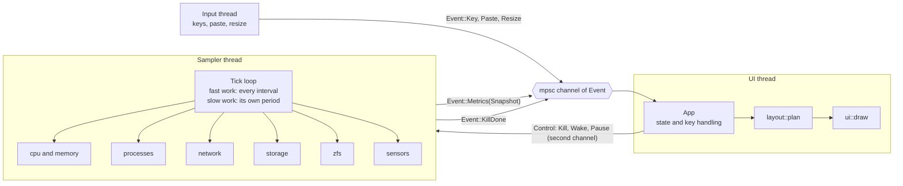
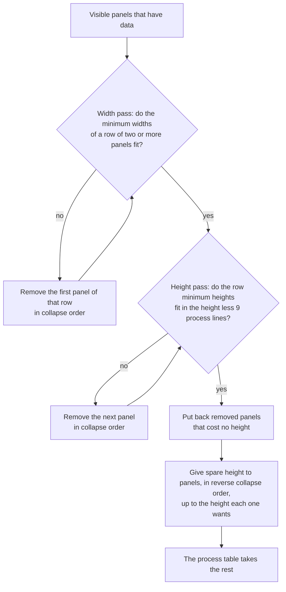
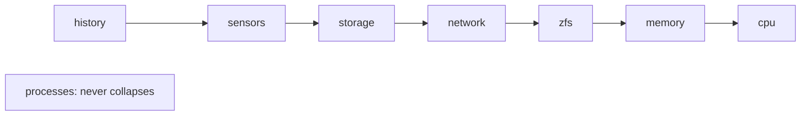

# Architecture

How the code fits together: the threads, the sampling cadence, the process collectors, the kill flow, the layout planner, the design principles and the source files. Read this page before you change the code. [CONTRIBUTING.md](../CONTRIBUTING.md) has the rules for changes.

## How it fits together

Three threads talk through channels. The sampler thread owns all the `sysinfo` handles and all the collectors. The UI thread owns the application state and draws.

Between ticks the sampler blocks on the control channel until the next tick is due. `Kill` is handled at once. `Wake` comes after `+` or `-`: the UI stores the new interval first, and the sampler reads it again. `Pause(true)` stops sampling; kills still work. On `Pause(false)` the sampler takes one sample that it does not send, so every rate has a fresh baseline, and sends the next sample one interval later.

## Sampling cadence

Each kind of work has its own period (`Clocks::plan` in `metrics.rs`). The UI publishes the set of panels it drew in the last frame in an atomic bit set, and the sampler skips some slow work for panels that are not drawn. The first tick does everything, whatever is drawn.

| Work | Period | Condition |
|---|---|---|
| CPU, memory, processes, network, disk I/O counters, ZFS counters | each tick | always |
| Disk list (space read only for new disks), battery, command lines that are still empty, other users' macOS processes, ZFS probe when absent | 5 s | always |
| User list | on a miss, at most each 60 s | 5 s work |
| Sensors: the 12 hottest of the last reading | 5 s | the sensors panel is drawn |
| Sensors: full scan | 30 s | the sensors panel is drawn, or the last reading had no temperatures |
| Disk space of all shown disks | 30 s | the storage panel is drawn |

Disk I/O counters are read on every tick whatever is drawn, so a rate never spans a gap. The disks of one I/O group (the mounts of one Linux device, the APFS volumes of one macOS whole disk) share the counter of one disk, read once.

## Process collectors

Each OS has one `ProcCollector` with the same interface: `collect` reads the process list for one tick, and `signal` does the kill check and sends the signal. `signal` reads the process identity with the same code as `collect`, so the two always agree.

| OS | Source | Identity (`ident`) | Calls on each tick |
|---|---|---|---|
| Linux | `/proc` directly (`process/linux.rs`) | `starttime` in clock ticks since boot | `stat` for each process, `io` where it can be read; kernel threads only on a 5 s tick |
| macOS | `libproc` directly (`process/macos.rs`) | `p_uniqueid`, unique for each process since boot | `PROC_PIDTASKALLINFO` and `proc_pid_rusage` for each readable process; other users' processes only on a 5 s tick |
| Windows, FreeBSD | `sysinfo` (`process/sysinfo_procs.rs`) | start time in seconds | what `sysinfo` reads |

The native collectors read the name and the command line once, when they first see a process. On macOS, another user's process gives its user, parent and state, but not its CPU, memory or threads, unless rtop runs as root.

## The kill flow

On Windows, the sampler opens the process, compares its creation time and terminates through that same handle. The sampler waits for the next tick on the control channel, so a kill starts at once, or once the current sample finishes.

## Layout collapse

`layout::plan` is a pure function. It takes the body area and the panels that the user shows and that have data. It returns the area for each panel and the list of panels it removed.

The collapse order, from the first panel to go to the last:

The panels sit in three rows above the process table: cpu and history, then memory and network, then storage, zfs and sensors. A row is as tall as its tallest panel's minimum, so removing a tall panel from a row can free space. At 80×24 with every panel shown, the three rows need 15 lines but only 13 are free, so history goes first. The footer then shows `· 1 hidden`. On a host that also has sensors, row three needs 88 columns (30 + 36 + 22), so sensors drops too and the footer shows `· 2 hidden`. The screenshot host has no sensors. The process table always keeps at least 9 lines (6 process rows).

## Principles

- **No locks.** The sampler moves each `Snapshot` into the channel. The two threads cannot touch the same data, and the compiler checks this. The only shared values are the refresh interval and the set of drawn panels, and both are atomics.
- **No busy loop.** The UI thread blocks on `recv()`. It then reads all waiting events, so a burst of keys costs one redraw. The sampler blocks on its control channel until the next tick.
- **The terminal resets after a panic.** `ratatui::run` restores raw mode and the alternate screen on every exit path, and a guard turns bracketed paste off again.
- **Logic without I/O.** Decisions live in pure functions: `app.rs` has no terminal code, `layout::plan` is pure, and `config::parse` and `zfs::parse_kstat` take text, not files. Plain unit tests cover them. The UI tests render into ratatui's `TestBackend`.
- **Cheap sampling.** A tick makes as few system calls as it can, and slow work runs on its own period (see [Sampling cadence](#sampling-cadence)). On an M5 Mac with about 600 processes, rtop uses about 0.3% of one core at a 1 s interval; `scripts/cpubench.py` measures it.
- **Few dependencies.** rtop has three direct crates on every OS: `anyhow`, `ratatui` and `sysinfo`, plus `libc` on Linux, macOS and FreeBSD. The config parser and the command-line parser are hand-written. `unsafe` code is for OS calls only (`libproc`, `sysctl`, `statfs`, `kill`, IOKit and Core Foundation, and the Windows process and power APIs), and each block has a `SAFETY` comment.

## File map

| File | Contents |
|---|---|
| `src/main.rs` | CLI parsing, the `--help` text, config loading, thread setup and the event loop |
| `src/metrics.rs` | The sampler thread, which owns the `sysinfo` handles and the collectors, plans the work of each tick and sends one `Snapshot` for each tick |
| `src/app.rs` | Application state, the history ring buffer, sort, filter and key handling |
| `src/ui.rs` | The frame, the header and footer, and the CPU, history, memory and network panels |
| `src/ui/` | One drawing file for each feature panel (`zfs.rs`, `storage.rs`, `sensors.rs`, `process.rs`, `net.rs`) and the help overlay (`help.rs`) |
| `src/layout.rs` | The pure layout planner: which panels fit, where they go and which collapse |
| `src/panel.rs` | Panel identities and the set of visible panels |
| `src/help.rs` | The key table (`KEYMAP`) that the help overlay and `--help` read |
| `src/config.rs` | The config parser and the default path rules |
| `src/process.rs` | Process data, sort, filter, the tree, the kill types, and helpers for the collectors |
| `src/process/` | One process collector for each source: `linux.rs` (`/proc`), `macos.rs` (`libproc`), `sysinfo_procs.rs` (Windows and FreeBSD) |
| `src/storage.rs` | Filesystem usage and disk I/O rates, with the macOS IOKit counter reader |
| `src/zfs.rs` | The ARC kstat parser, the hit-ratio window and a reader for each OS |
| `src/sensors.rs` | Temperatures and the battery reader for each OS |
| `src/net.rs` | Per-interface network rates and totals, with native readers for Linux (`/sys/class/net`) and macOS (`sysctl`) |
| `src/format.rs` | Formatters for bytes, rates and durations, and the bar meter |
| `src/order.rs` | One shared stable sort, which keeps the binary small |

The full design for the feature round that added the ZFS, storage, sensors and process features is in [`docs/designs/features/2026-10-16-rtop-feature-round-1.md`](designs/features/2026-10-16-rtop-feature-round-1.md). Where it differs from the code, the code is correct.

For the hit-ratio window that the ZFS panel uses, see [How the hit ratio works](zfs.md#how-the-hit-ratio-works). A shorter module map is in [`src/README.md`](../src/README.md).
