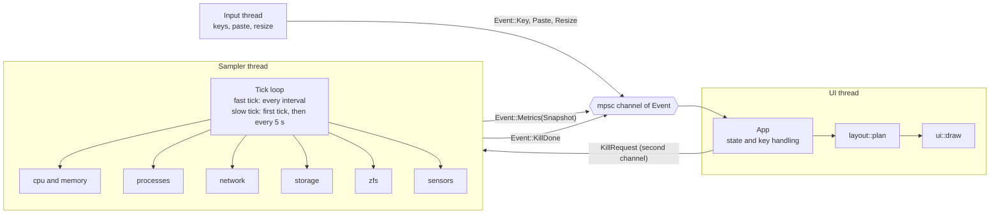
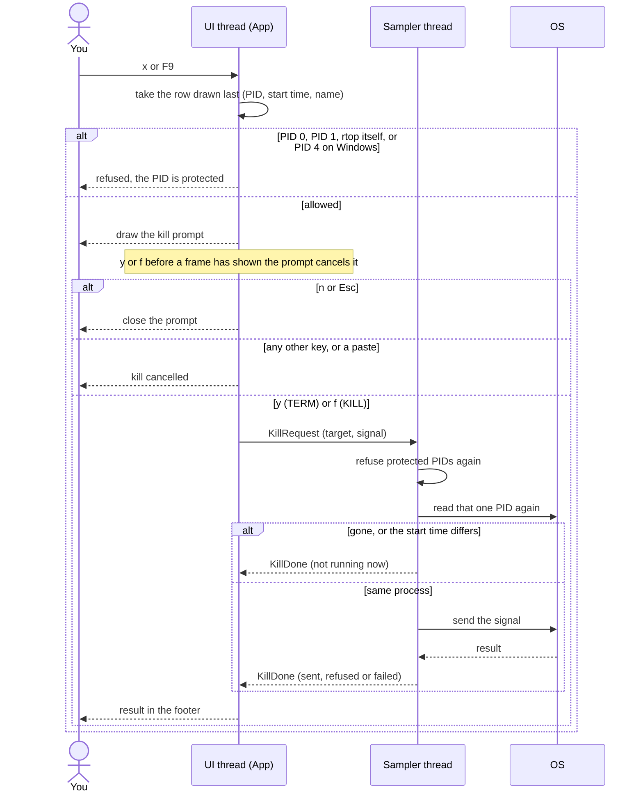
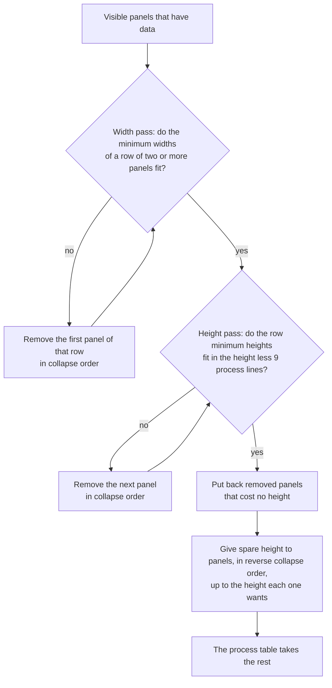
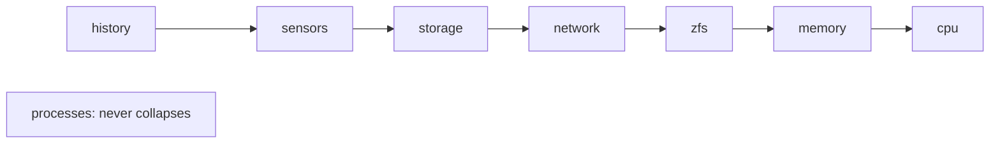

# Architecture

How the code fits together: the threads, the kill flow, the layout planner, the design principles and the source files. Read this page before you change the code. [CONTRIBUTING.md](../CONTRIBUTING.md) has the rules for changes.

## How it fits together

Three threads talk through channels. The sampler thread owns all the `sysinfo` handles and all the collectors. The UI thread owns the application state and draws.

Fast ticks read the CPU, memory, processes, network, disk I/O counters and ZFS counters. Slow ticks add the work that costs more: the disk list and space, sensors and the battery, the user list, command lines and macOS thread counts. A host without ZFS is checked again only on a slow tick.

## The kill flow

On Windows, the sampler opens the process, compares its creation time and terminates through that same handle. The sampler checks the kill channel every 50 ms while it waits for the next tick, so a kill starts within about 50 ms, or once the current sample finishes.

## Layout collapse

`layout::plan` is a pure function. It takes the body area and the panels that the user shows and that have data. It returns the area for each panel and the list of panels it removed.

The collapse order, from the first panel to go to the last:

The panels sit in three rows above the process table: cpu and history, then memory and network, then storage, zfs and sensors. A row is as tall as its tallest panel's minimum, so removing a tall panel from a row can free space. At 80×24 with every panel shown, the three rows need 15 lines but only 13 are free, so history goes first. The footer then shows `· 1 hidden`. On a host that also has sensors, row three needs 88 columns (30 + 36 + 22), so sensors drops too and the footer shows `· 2 hidden`. The screenshot host has no sensors. The process table always keeps at least 9 lines (6 process rows).

## Principles

- **No locks.** The sampler moves each `Snapshot` into the channel. The two threads cannot touch the same data, and the compiler checks this. The refresh interval is the only shared value, and it is an atomic.
- **No busy loop.** The UI thread blocks on `recv()`. It then reads all waiting events, so a burst of keys costs one redraw.
- **The terminal resets after a panic.** `ratatui::run` restores raw mode and the alternate screen on every exit path, and a guard turns bracketed paste off again.
- **Logic without I/O.** Decisions live in pure functions: `app.rs` has no terminal code, `layout::plan` is pure, and `config::parse` and `zfs::parse_kstat` take text, not files. Plain unit tests cover them. The UI tests render into ratatui's `TestBackend`.
- **Cheap sampling.** Slow work runs on a slow tick every 5 seconds, so a 250 ms interval stays light.
- **Few dependencies.** rtop has three direct crates on every OS: `anyhow`, `ratatui` and `sysinfo`. The config parser and the command-line parser are hand-written. `unsafe` code is for OS calls only (`sysctlbyname`, `statfs`, `proc_pidinfo`, IOKit power sources, and the Windows process and power APIs), and each block has a `SAFETY` comment.

## File map

| File | Contents |
|---|---|
| `src/main.rs` | CLI parsing, the `--help` text, config loading, thread setup and the event loop |
| `src/metrics.rs` | The sampler thread, which owns the `sysinfo` handles and the collectors and sends one `Snapshot` for each tick |
| `src/app.rs` | Application state, the history ring buffer, sort, filter and key handling |
| `src/ui.rs` | The frame, the header and footer, and the CPU, history, memory and network panels |
| `src/ui/` | One drawing file for each feature panel (`zfs.rs`, `storage.rs`, `sensors.rs`, `process.rs`, `net.rs`) and the help overlay (`help.rs`) |
| `src/layout.rs` | The pure layout planner: which panels fit, where they go and which collapse |
| `src/panel.rs` | Panel identities and the set of visible panels |
| `src/help.rs` | The key table (`KEYMAP`) that the help overlay and `--help` read |
| `src/config.rs` | The config parser and the default path rules |
| `src/process.rs` | Process data, sort, filter, the tree and kill |
| `src/storage.rs` | Filesystem usage and disk I/O rates |
| `src/zfs.rs` | The ARC kstat parser, the hit-ratio window and a reader for each OS |
| `src/sensors.rs` | Temperatures and the battery reader for each OS |
| `src/net.rs` | Per-interface network rates and totals |
| `src/format.rs` | Formatters for bytes, rates and durations, and the bar meter |
| `src/order.rs` | One shared stable sort, which keeps the binary small |

The full design for the feature round that added the ZFS, storage, sensors and process features is in [`docs/designs/features/2026-10-16-rtop-feature-round-1.md`](designs/features/2026-10-16-rtop-feature-round-1.md). Where it differs from the code, the code is correct.

For the hit-ratio window that the ZFS panel uses, see [How the hit ratio works](zfs.md#how-the-hit-ratio-works). A shorter module map is in [`src/README.md`](../src/README.md).
