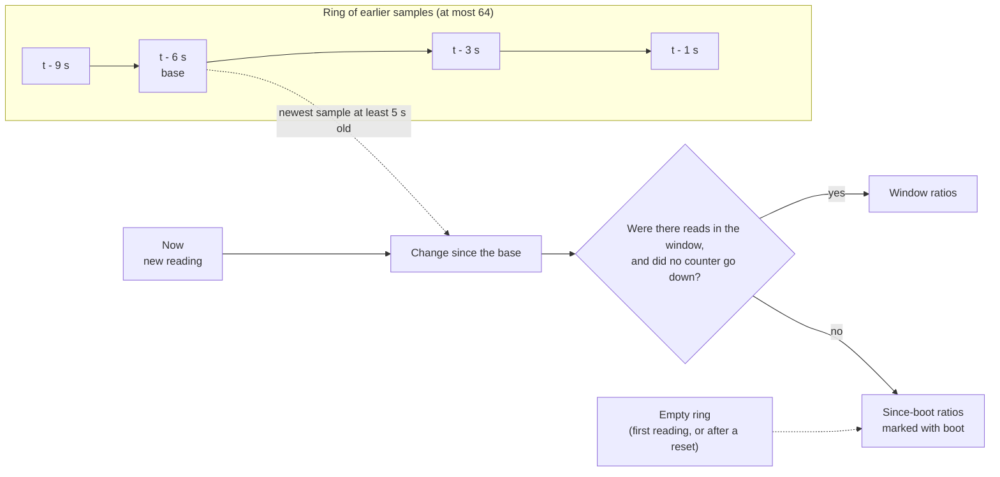

# ZFS ARC

rtop has a ZFS ARC panel. This page tells you what it shows, how it reads the hit ratio, how it treats the ARC as free memory, where the data comes from, and how to try the panel on a host without ZFS.

> "none of them report ZFS ARC stats, so I gave up and went back to top"
>
> — a user

Many terminal monitors leave out the ZFS ARC. On a ZFS host, the ARC can hold a large share of RAM. On Linux, the kernel's `MemAvailable` figure leaves the ARC out, so a tool that trusts it shows the ARC as used memory.

## What the panel shows

- The ARC size, the target, and the minimum and maximum sizes, with a gauge.
- Hit ratio, I/O-hit ratio and miss ratio, and the demand data (`dd`) and demand metadata (`dm`) hit ratios.
- Hit ratios are for a 5 second window. The panel marks a value as `boot` when it is a since-boot ratio. See [How the hit ratio works](#how-the-hit-ratio-works).
- The MFU and MRU sizes with a split bar. The data and metadata sizes. The compression ratio.
- The L2ARC size, allocated size and hit ratio, when an L2ARC exists.
- On Linux, the memory gauge counts the shrinkable ARC as free memory. See [The ARC as free memory](#the-arc-as-free-memory).
- The panel appears only when ZFS is loaded. See [Data sources](#data-sources).

The ARC reader has only been tested with synthetic fixtures, not on a real ZFS pool. See [What is tested](platforms.md#what-is-tested) before you rely on the numbers.

## How the hit ratio works

The ZFS counters only go up, so a ratio since boot hides what the cache is doing now. rtop keeps a ring of earlier readings (at most 64) and compares the new reading with a base reading.



- The base is the newest sample that is at least 5 seconds old. Until one is that old, it is the oldest sample, so the window is shorter than 5 seconds at start-up.
- If the pool did no reads in the window, or a counter went down (for example after a module reload), the panel shows since-boot ratios with a `boot` label, so you know they are not live.
- `hit` is hits divided by all reads (hits, I/O hits and misses). `io` is the I/O-hit share, and `miss` is what is left. `dd` and `dm` are the hit ratios for demand data and demand metadata reads.
- On a narrow panel, the hit line drops `dm`, `dd`, `miss` and `io`, in that order.

## The ARC as free memory

The ARC shrinks when applications need memory. The kernel's `MemAvailable` figure on Linux leaves the ARC out, so a tool that trusts it shows the ARC as used memory. How rtop treats the ARC depends on the OS:

- **Linux.** rtop counts the shrinkable ARC (size minus `c_min`) as free memory, so the memory gauge shows what applications use. htop does the same.
- **FreeBSD.** `sysinfo` subtracts the ARC from used memory.
- **macOS.** rtop does not adjust the memory gauge.
- **Every OS that has ZFS.** The memory panel also shows the ARC size.

## Data sources

| OS | Source |
|---|---|
| Linux | `/proc/spl/kstat/zfs/arcstats` |
| FreeBSD | `kstat.zfs.misc.arcstats.*`, read by `sysctl` |
| macOS (OpenZFS on OS X) | `kstat.zfs.misc.arcstats.*`, read by `sysctl` |
| Windows | None. There is no ARC reader. |

The panel appears only when ZFS is loaded. A host without ZFS is checked again only on a slow tick (every 5 seconds).

## Try the panel without ZFS

A debug build (`cargo run`, not `--release`) reads the ARC counters from a file when `RTOP_ZFS_ARCSTATS` is set. A release build ignores the variable.

```sh
RTOP_ZFS_ARCSTATS=testdata/arcstats-2.2.txt cargo run
```

The file does not change, so there are no reads in the window. The hit values then show the since-boot ratios with the `boot` label. The fixtures in `testdata/` are synthetic.

Details of the fixtures are in [`testdata/README.md`](../testdata/README.md).
